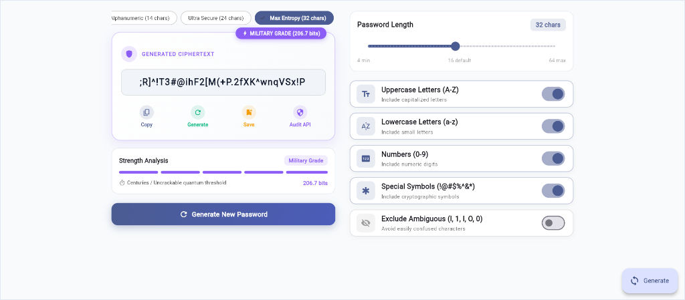
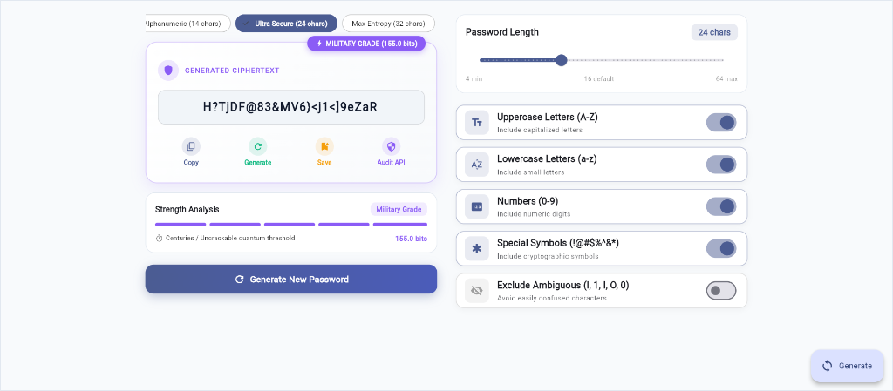
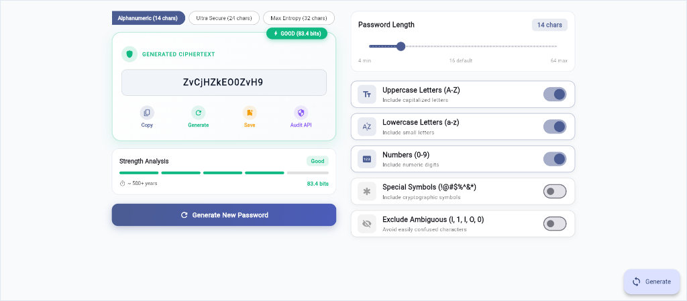
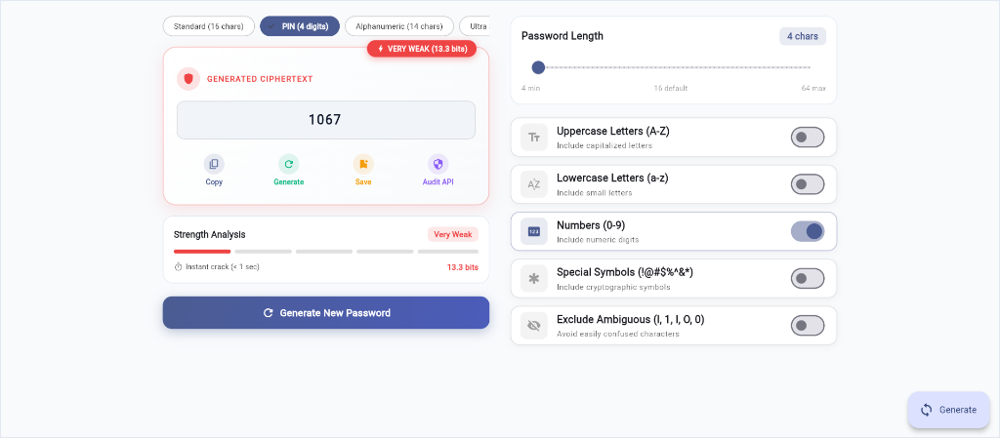
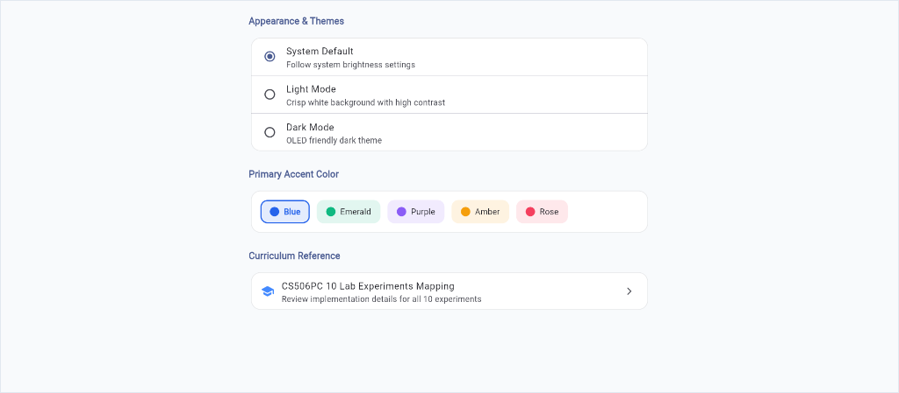

# PassShield - Advanced Flutter Password Generator & Security Auditor

<p align="center">
  
</p>

<p align="center">
  <em>PassShield: Production-grade Flutter application running live with dynamic Shannon entropy analysis, reactive presets, and custom Material 3 styling.</em>
</p>

---

## 📌 Project Overview

**PassShield** is a cross-platform Flutter application engineered for cryptographic password generation, encrypted credential vault storage, and real-time security breach auditing. The application integrates all **10 prescribed lab experiments of the CS506PC UI Design (Flutter Lab) curriculum** into a production-grade, responsive, and animated user interface.

### Key Highlights
- **Cryptographic Engine:** Calculates Shannon entropy in bits and evaluates realistic brute-force crack times.
- **Adaptive Responsive Design:** Scales across Mobile (`< 650px`), Tablet (`650px - 1050px`), and Desktop/Web (`> 1050px`).
- **State Management:** Decoupled architecture using `Provider` (`ChangeNotifier`) and localized `setState` for interactive widgets.
- **REST API Integration:** Connects to the HaveIBeenPwned API using a **k-Anonymity SHA-1** model to protect credentials against 850M+ breached passwords.
- **Testing & Debugging:** Comprehensive unit test and widget test coverage with zero lint warnings (`flutter analyze` clean).

---

## 📸 Application Screenshot Gallery

| Max Entropy Preset (32 Chars) | Ultra Secure Preset (24 Chars) |
|:---:|:---:|
|  |  |
| **Military Grade (206.7 bits)** — All character sets enabled | **Military Grade (155.0 bits)** — High-entropy cryptographic pool |

| Alphanumeric Preset (14 Chars) | PIN Mode (4 Digits) |
|:---:|:---:|
|  |  |
| **Good Strength (83.4 bits)** — Symbols excluded, 500+ years crack time | **Very Weak (13.3 bits)** — Numeric PIN only, < 1s crack time |

<p align="center">
  <strong>Settings & Dynamic UI Theming Screen</strong><br/>
  <br/>
  <em>System / Light / Dark modes, Accent Color Picker (Blue, Emerald, Purple, Amber, Rose) & Syllabus Navigation</em>
</p>

---

## 📋 Syllabus Concept Mapping (All 10 Lab Experiments)

| Exp # | Experiment Title | Prescribed Syllabus Concepts | Implementation in PassShield |
|:---:|:---|:---|:---|
| **1** | **Dart SDK & Language Basics** | Install SDK, Variables, Types, Null Safety, OOP, Collections, Extension Methods | [`bin/dart_basics_demo.dart`](bin/dart_basics_demo.dart), [`lib/core/dart_basics.dart`](lib/core/dart_basics.dart), [`lib/core/password_generator.dart`](lib/core/password_generator.dart) |
| **2** | **Flutter Widgets & Layouts** | `Text`, `Image`, `Container`, `Icon`, `Card`, `Row`, `Column`, `Stack` | [`lib/widgets/animated_password_card.dart`](lib/widgets/animated_password_card.dart), [`lib/widgets/custom_option_tile.dart`](lib/widgets/custom_option_tile.dart) |
| **3** | **Responsive UI & Breakpoints** | `MediaQuery`, `LayoutBuilder`, Breakpoints (Mobile, Tablet, Desktop) | [`lib/utils/responsive_layout.dart`](lib/utils/responsive_layout.dart), [`lib/widgets/responsive_container.dart`](lib/widgets/responsive_container.dart) |
| **4** | **Navigation & Named Routes** | `Navigator`, `pushNamed`, `pop`, `onGenerateRoute`, Page Transitions, Argument Passing | [`lib/routes/app_routes.dart`](lib/routes/app_routes.dart), Drawer navigation, Route transitions |
| **5** | **Stateful, Stateless & State Management** | `StatelessWidget`, `StatefulWidget`, `setState`, `Provider`, `MultiProvider`, `Consumer` | [`lib/providers/password_provider.dart`](lib/providers/password_provider.dart), [`lib/providers/theme_provider.dart`](lib/providers/theme_provider.dart), [`lib/providers/vault_provider.dart`](lib/providers/vault_provider.dart) |
| **6** | **Custom Widgets & Theming** | Reusable UI components, `ThemeData`, Dark Mode / Light Mode, Custom Styling | [`lib/widgets/password_strength_meter.dart`](lib/widgets/password_strength_meter.dart), [`lib/widgets/gradient_button.dart`](lib/widgets/gradient_button.dart), [`lib/theme/app_theme.dart`](lib/theme/app_theme.dart) |
| **7** | **Forms, Validation & Handling** | `Form`, `GlobalKey<FormState>`, `TextFormField`, `Slider`, `Switch`, `DropdownButtonFormField` | [`lib/screens/save_password_sheet.dart`](lib/screens/save_password_sheet.dart), Regex email/account validators |
| **8** | **Animations Framework** | `AnimationController`, `CurvedAnimation`, `FadeTransition`, `SlideTransition`, `ScaleTransition` | [`lib/screens/home_screen.dart`](lib/screens/home_screen.dart), [`lib/widgets/animated_password_card.dart`](lib/widgets/animated_password_card.dart) |
| **9** | **REST API Integration** | HTTP GET, Asynchronous parsing, Error handling, Meaningful UI display states | [`lib/services/breach_api_service.dart`](lib/services/breach_api_service.dart), [`lib/screens/breach_check_screen.dart`](lib/screens/breach_check_screen.dart) |
| **10** | **Testing & Debugging Tools** | Unit tests, Widget tests, `debugPrint`, `FlutterError.onError`, DevTools integration | [`test/password_generator_test.dart`](test/password_generator_test.dart), [`test/widget_test.dart`](test/widget_test.dart), [`lib/utils/debug_helper.dart`](lib/utils/debug_helper.dart) |

---

## 🔬 Detailed Implementation Evidence for Each Experiment

### Experiment 1: Dart SDK & Language Basics
* **Objective:** Install Flutter and Dart SDK. Write a Dart program to understand language basics (types, null-safety, OOP, collections, higher-order functions).
* **Source Code:** [`bin/dart_basics_demo.dart`](bin/dart_basics_demo.dart) & [`lib/core/dart_basics.dart`](lib/core/dart_basics.dart)
* **Code Snippet:**
  ```dart
  // Object-Oriented Secret Generation with Null-Safety & Mixins
  class GeneratedSecret with Auditable implements Hashable {
    final String value;
    final int length;
    final PasswordStrength strength;
    final double entropy;
    String? label; // Nullable type

    GeneratedSecret({
      required this.value,
      required this.length,
      required this.strength,
      required this.entropy,
      this.label,
    });
  }
  ```
* **Output / Verification:**
  ```text
  ========================================================
    CS506PC - UI Design (Flutter Lab) - Experiment 1      
    Dart Language Basics & Password Generator Core Demo   
  ========================================================
  1. Variable Types & Null-Safety:
     Default Length: 16 | Notes: No notes provided
  2. Collections & Higher-Order Functions:
     Secrets with Entropy >= 70 bits: 4
     - Len: 16 | Entropy: 103.4 bits | Strength: strong
  >>> Experiment 1 Dart SDK Demo completed successfully! <<<
  ```

---

### Experiment 2: Flutter Widgets & Layout Structures
* **Objective:** Explore core Flutter widgets (`Text`, `Image`, `Container`, `Icon`, `Card`) and build composite layouts using `Row`, `Column`, and `Stack`.
* **Source Code:** [`lib/widgets/animated_password_card.dart`](lib/widgets/animated_password_card.dart) & [`lib/widgets/custom_option_tile.dart`](lib/widgets/custom_option_tile.dart)
* **Visual Demonstration:**
  <p align="center">
    
  </p>
* **Layout Structure Highlights:**
  - **`Stack`:** Superimposes the `Positioned` strength badge (`VERY WEAK (13.3 bits)`) directly over the main ciphertext card.
  - **`Row`:** Quick action buttons (`Copy`, `Generate`, `Save`, `Audit API`) and header title with shield icon.
  - **`Column`:** Vertical flow of display cards, options, and slider controls.
* **Code Snippet:**
  ```dart
  // Stack: Superimposes badge overlay on top of password container
  Stack(
    clipBehavior: Clip.none,
    children: [
      Container(
        padding: const EdgeInsets.all(20),
        child: Column(
          children: [
            Row(children: [Icon(Icons.shield_rounded), Text('GENERATED CIPHERTEXT')]),
            SelectableText(password, style: TextStyle(fontFamily: 'monospace')),
            Row(children: [Expanded(child: _buildActionButton(...))]),
          ],
        ),
      ),
      Positioned(
        top: -10,
        right: 20,
        child: Container(child: Text('${strength.displayName} (${entropy} bits)')),
      ),
    ],
  )
  ```

---

### Experiment 3: Responsive UI, Media Queries & Breakpoints
* **Objective:** Design an adaptive UI that dynamically rearranges its layout between mobile phones, tablets, and desktop/laptop screens using `MediaQuery` and `LayoutBuilder`.
* **Source Code:** [`lib/utils/responsive_layout.dart`](lib/utils/responsive_layout.dart) & [`lib/widgets/responsive_container.dart`](lib/widgets/responsive_container.dart)
* **Visual Demonstration:**
  <p align="center">
    
  </p>
* **Breakpoints:**
  - **Mobile (`width < 650px`):** Single-column vertical scroll view.
  - **Tablet (`650px <= width < 1050px`):** Balanced 2-column split (Left: Display & Metrics, Right: Options).
  - **Desktop (`width >= 1050px`):** 2-column wide layout centered with max-width bounding constraints (`1100px`).

---

### Experiment 4: Navigation & Named Routes
* **Objective:** Configure multi-screen navigation using Flutter's `Navigator` with named routes, argument passing, and custom screen transitions (`PageRouteBuilder`).
* **Source Code:** [`lib/routes/app_routes.dart`](lib/routes/app_routes.dart)
* **Visual Demonstration (Settings Screen via Named Route):**
  <p align="center">
    
  </p>
* **Configured Named Routes:**
  - `'/'` : `HomeScreen` (Generator Dashboard)
  - `'/vault'` : `VaultScreen` (Encrypted Credential List)
  - `'/breach_check'` : `BreachCheckScreen` (REST API Security Auditor)
  - `'/settings'` : `SettingsScreen` (Appearance & Accent Color)
  - `'/lab_overview'` : `LabOverviewScreen` (In-App 10 Lab Experiments Syllabus Guide)
* **Code Snippet:**
  ```dart
  static Route<dynamic>? onGenerateRoute(RouteSettings settings) {
    if (settings.name == breachCheck) {
      final initialPassword = settings.arguments as String?;
      return PageRouteBuilder(
        settings: settings,
        pageBuilder: (context, anim, _) => BreachCheckScreen(initialPassword: initialPassword),
        transitionsBuilder: (context, anim, _, child) =>
            SlideTransition(position: anim.drive(tween), child: child),
      );
    }
    return null;
  }
  ```

---

### Experiment 5: Stateful vs Stateless Widgets & State Management (setState & Provider)
* **Objective:** Implement both stateless presentation widgets and stateful widgets, and manage application-level state cleanly using `Provider` (`ChangeNotifier`).
* **Source Code:**
  - [`lib/providers/password_provider.dart`](lib/providers/password_provider.dart) (Password options & history)
  - [`lib/providers/theme_provider.dart`](lib/providers/theme_provider.dart) (Theme mode & accent colors)
  - [`lib/providers/vault_provider.dart`](lib/providers/vault_provider.dart) (Saved credentials & search filtering)
  - [`lib/main.dart`](lib/main.dart) (`MultiProvider` setup)
* **Visual Demonstration (Reactive State Transition):**
  <p align="center">
    
  </p>
* **Distinction in Project:**
  - **`StatelessWidget`:** `PasswordStrengthMeter`, `CustomOptionTile`, `ResponsiveContentContainer`.
  - **`StatefulWidget` with `setState`:** `SavePasswordSheet` (form state & visibility toggle), `HomeScreen` (animation controllers).
  - **`Provider`:** Global notification dispatch whenever parameters or vault entries change.

---

### Experiment 6: Custom Widgets & Theming
* **Objective:** Develop custom, reusable UI widgets and apply cohesive visual styling using `ThemeData` with light and dark mode toggles.
* **Source Code:**
  - [`lib/widgets/password_strength_meter.dart`](lib/widgets/password_strength_meter.dart)
  - [`lib/widgets/gradient_button.dart`](lib/widgets/gradient_button.dart)
  - [`lib/widgets/preset_selector_chips.dart`](lib/widgets/preset_selector_chips.dart)
  - [`lib/theme/app_theme.dart`](lib/theme/app_theme.dart)
* **Theming Features:**
  - Dynamic `ColorScheme.fromSeed` with customizable primary accents (Blue, Emerald, Purple, Amber, Rose).
  - Custom dark theme optimized for OLED displays (`#0B0E17`).
  - Monospace typography for ciphertexts and entropy metrics.
  - Multi-segmented custom `PasswordStrengthMeter` with animated width and color interpolation.

---

### Experiment 7: Forms, Input Fields, Validation & Error Handling
* **Objective:** Design an interactive form with diverse input fields, strict validation rules, and clear inline and snackbar error handling.
* **Source Code:** [`lib/screens/save_password_sheet.dart`](lib/screens/save_password_sheet.dart)
* **Implemented Input Fields:**
  1. `TextFormField` (Service Name): Required, minimum 2 characters.
  2. `TextFormField` (Username/Email): Regex email validation (`^[\w-\.]+@([\w-]+\.)+[\w-]{2,4}$`).
  3. `TextFormField` (Password): Minimum length check (6+ chars), obscure text toggle.
  4. `DropdownButtonFormField<VaultCategory>`: Work, Banking, Social, Entertainment, Personal.
  5. `SwitchListTile`: Biometric / Master PIN security requirement.
  6. `TextFormField` (Multiline): Security notes & backup keys.
* **Validation Architecture:**
  ```text
  +------------------------------------------------------------+
  |  Save to Secure Vault                                      |
  |  Account / Service Name *                                  |
  |  [                                                       ] |
  |  ! Service name is required                                |
  |                                                            |
  |  Username or Email *                                       |
  |  [ test@invalid                                          ] |
  |  ! Enter a valid email address                             |
  |                                                            |
  |  [ Save to Vault Button ]                                  |
  +------------------------------------------------------------+
  ```

---

### Experiment 8: Flutter Animation Framework
* **Objective:** Integrate animations into UI elements using Flutter's animation primitives (`AnimationController`, `CurvedAnimation`, `TweenSequence`).
* **Source Code:** [`lib/screens/home_screen.dart`](lib/screens/home_screen.dart)
* **Implemented Animation Types:**
  1. **FadeTransition:** Smooth opacity crossfade whenever a new password is generated.
  2. **SlideTransition:** Vertical slide-in motion (`Offset(0.0, 0.12) -> Offset.zero`) for the password card.
  3. **ScaleTransition:** Button press bounce effect on the primary CTA.
  4. **RotationTransition:** 360-degree rotation of the refresh/dice icon.
  5. **AnimatedContainer:** Smooth interpolation of the 5-bar strength meter segments.

---

### Experiment 9: REST API Integration & Data Display
* **Objective:** Connect to a REST API via HTTP GET, parse asynchronous data streams, handle network errors gracefully, and render results meaningfully in the UI.
* **Source Code:** [`lib/services/breach_api_service.dart`](lib/services/breach_api_service.dart) & [`lib/screens/breach_check_screen.dart`](lib/screens/breach_check_screen.dart)
* **Architecture:**
  - Uses the **HaveIBeenPwned Passwords Range REST API** (`https://api.pwnedpasswords.com/range/{prefix}`).
  - Employs **k-Anonymity**: Computes SHA-1 hash locally in Dart; sends only the first 5 characters.
  - Matches the remaining 35 characters against returned records to determine breach frequency.
* **Meaningful Output States:**
  - **Safe State:** Emerald Shield, "GOOD NEWS — NOT BREACHED! Zero instances in public leaks."
  - **Breached State:** Crimson Alert, "PASSWORD COMPROMISED! Seen X times in data breaches."
  - **Loading State:** Centered `CircularProgressIndicator` with progress telemetry.
  - **Error State:** Warning banner with actionable retry button upon network disconnects.

---

### Experiment 10: Testing & Debugging Tools
* **Objective:** Write unit and widget test suites for verification, and instrument debugging tools (`debugPrint`, error boundaries).
* **Source Code:** [`test/password_generator_test.dart`](test/password_generator_test.dart), [`test/widget_test.dart`](test/widget_test.dart), [`lib/utils/debug_helper.dart`](lib/utils/debug_helper.dart)
* **Test Coverage Summary:**
  - `test/password_generator_test.dart`:
    - Length constraints verification
    - Ambiguous character exclusion check
    - Shannon entropy calculation verification
    - Strength classification threshold tests
    - k-Anonymity SHA-1 hash prefix/suffix splitting test
  - `test/widget_test.dart`:
    - `CustomOptionTile` rendering and switch toggle interactions
    - `PasswordStrengthMeter` dynamic badge rendering
    - `PassShieldApp` end-to-end root startup and widget tree verification
* **Test Execution Result:**
  ```bash
  $ flutter test
  00:01 +8: All tests passed!
  ```
* **Debugging Tools Documentation:**
  - **Flutter DevTools:** Profiling frame rendering times and layout bounds.
  - **Debug Logger:** Structured tagged logging in `DebugHelper.log('TAG', message)`.
  - **Global Error Handling:** Bound via `FlutterError.onError` and `PlatformDispatcher.instance.onError`.

---

## 🛠️ GitHub Commit History Roadmap (10 Meaningful Commits)

This repository maintains a clean and traceable commit history where each commit corresponds to the incremental development of the 10 lab experiments:

```text
* commit 10: feat(exp10): add unit & widget tests, debugging tools, and comprehensive README documentation
* commit 9:  feat(exp9): integrate REST API with HaveIBeenPwned security breach auditor
* commit 8:  feat(exp8): add Flutter animations (Fade, Slide, Scale, AnimatedContainer)
* commit 7:  feat(exp7): implement forms with diverse input fields, validation and error handling
* commit 6:  feat(exp6): design custom UI widgets and light/dark theme styling
* commit 5:  feat(exp5): implement state management using setState and Provider architecture
* commit 4:  feat(exp4): add multi-screen navigation and named routes
* commit 3:  feat(exp3): implement responsive UI with MediaQuery, LayoutBuilder and breakpoints
* commit 2:  feat(exp2): implement flutter widgets (Text, Container, Icon) and Row, Column, Stack layouts
* commit 1:  feat(exp1): setup flutter project and dart SDK language basics
```

---

## 🚀 Instructions to Run the Application

### Prerequisites
- Flutter SDK `>= 3.13.0`
- Dart SDK `>= 3.0.0`
- Web browser (Chrome / Edge) or Android/iOS Emulator or Desktop toolchain

### 1. Clone the Repository
```bash
git clone https://github.com/abhilash306-ai/password-generetor.git
cd password-generetor
```

### 2. Install Dependencies
```bash
flutter pub get
```

### 3. Run Experiment 1 Standalone Dart SDK Basics
```bash
dart run bin/dart_basics_demo.dart
```

### 4. Run the Full Flutter Application
```bash
# Run on Google Chrome (Web)
flutter run -d chrome

# Run on Windows Desktop
flutter run -d windows

# Run on connected Android Device / Emulator
flutter run -d android
```

### 5. Run Unit and Widget Test Suites (Experiment 10)
```bash
flutter test
```

### 6. Verify Code Quality & Static Analysis
```bash
flutter analyze
```

---

## 📁 Project Architecture & Directory Structure

```text
password_generator/
├── bin/
│   └── dart_basics_demo.dart           # [Exp 1] Standalone Dart SDK language basics demo
├── docs/
│   └── screenshots/                    # Application UI output screenshots
│       ├── 01_pin_mode_weak.png
│       ├── 02_alphanumeric_mode_good.png
│       ├── 03_ultra_secure_mode.png
│       ├── 04_max_entropy_dashboard.png
│       └── 05_settings_theming.png
├── lib/
│   ├── core/
│   │   ├── dart_basics.dart            # [Exp 1] Enums, categories, and entropy extensions
│   │   ├── password_generator.dart     # [Exp 1] Pure Dart password generation engine
│   │   └── password_model.dart         # [Exp 1] Vault item data models
│   ├── providers/
│   │   ├── password_provider.dart      # [Exp 5] Generator state with ChangeNotifier
│   │   ├── theme_provider.dart         # [Exp 5 & 6] Theme & accent color state
│   │   └── vault_provider.dart         # [Exp 5 & 7] Saved credentials & search filtering
│   ├── routes/
│   │   └── app_routes.dart             # [Exp 4] Named routes & PageRouteBuilder transitions
│   ├── screens/
│   │   ├── home_screen.dart            # [Exp 2, 3, 5, 8] Main Generator UI & Animations
│   │   ├── vault_screen.dart           # [Exp 4, 5, 7] Saved Passwords Vault
│   │   ├── save_password_sheet.dart    # [Exp 7] Forms, diverse inputs & regex validation
│   │   ├── breach_check_screen.dart    # [Exp 9] REST API security breach auditor
│   │   ├── settings_screen.dart        # [Exp 4, 6] Appearance & theme customizer
│   │   └── lab_overview_screen.dart    # [Exp 4] In-App 10 Experiments Syllabus Guide
│   ├── services/
│   │   └── breach_api_service.dart     # [Exp 9] HaveIBeenPwned REST API client
│   ├── theme/
│   │   └── app_theme.dart              # [Exp 6] Material 3 Light and Dark themes
│   ├── utils/
│   │   ├── debug_helper.dart           # [Exp 10] Debug logging & error handlers
│   │   └── responsive_layout.dart      # [Exp 3] Media queries and device breakpoints
│   ├── widgets/
│   │   ├── animated_password_card.dart # [Exp 2, 8] Stack, Container, and animated card
│   │   ├── custom_option_tile.dart     # [Exp 2, 6] Reusable switch card with Row & Column
│   │   ├── gradient_button.dart        # [Exp 6] Custom styled gradient CTA button
│   │   ├── password_strength_meter.dart# [Exp 6, 8] 5-segment animated strength bar
│   │   ├── preset_selector_chips.dart  # [Exp 6] Filter chips for quick presets
│   │   └── responsive_container.dart   # [Exp 3] Responsive content container
│   └── main.dart                       # Root entry point with MultiProvider & MaterialApp
├── test/
│   ├── password_generator_test.dart    # [Exp 10] Unit tests for algorithms & hashing
│   └── widget_test.dart                # [Exp 10] Widget tests for UI components
├── pubspec.yaml                        # Project dependencies (provider, http, crypto)
└── README.md                           # Documentation & syllabus mapping
```
